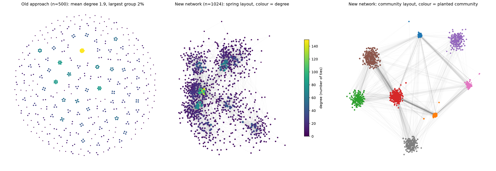
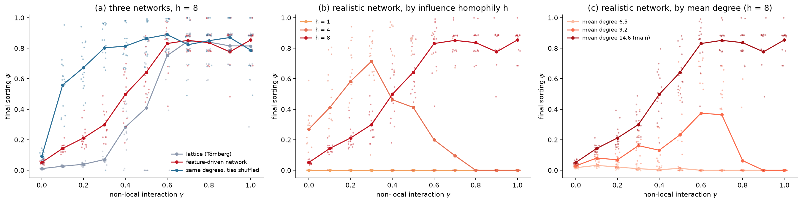
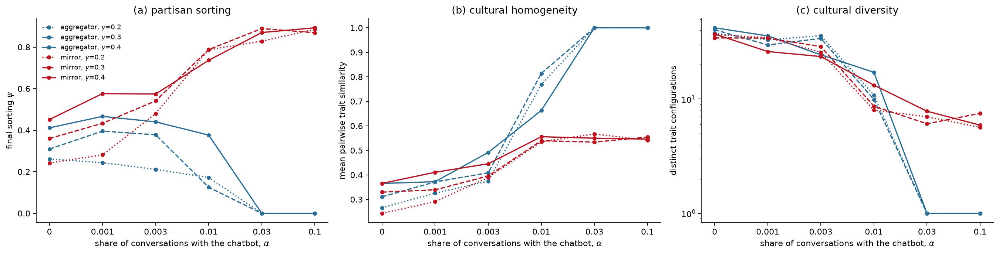

# Realistic polarisation sim

Does online contact sort society into two party cultures on a *realistic* social network, and what changes when everyone also talks to an AI chatbot?

1. **Build a realistic social network** with Băbeanu's feature-driven graph model: heavy-tailed degrees, high clustering, communities, short paths.
2. **Validate Törnberg (2022)** on it: does contact with strangers still drive partisan sorting?
3. **Extend it with AI** (idea from Balázs Vedres): add a chatbot as a conversation partner, in two evidence-backed forms: an *aggregator* (gives everyone the population's majority view) and a *mirror* (tells you what your own party thinks).

## Notebooks

| | |
|---|---|
| [`01_feature_driven_network.ipynb`](01_feature_driven_network.ipynb) | Building the realistic social network |
| [`02_tornberg_sorting.ipynb`](02_tornberg_sorting.ipynb) | Törnberg's sorting model on it, plus the chatbot extension |

Explainers: [the network](docs/01_realistic_network.md) · [the AI extension](docs/02_ai_chatbots.md)

## Key results

**The network.** 1,024 people, mean degree ≈ 14.5, clustering 0.29 (0.05 for the same degrees shuffled), modularity 0.69, ≈ 3 steps between any two people.



**Sorting on it.** More contact with strangers (γ) still means more sorting, as Törnberg found. Communities slow it down, and the mean number of contacts matters most.



**With a chatbot.** At a realistic 20–40% contact with strangers, a mirror chatbot in 1% of conversations lifts sorting from ≈ 0.3 to ≈ 0.8. An aggregator in 3% of conversations merges everyone into one culture.



## Run

```bash
conda env create -f environment.yml
conda activate socnet-polar
jupyter lab
```

Run notebook 1 first (it saves the network to `data/`), then notebook 2.

## Credits

- Törnberg, P. (2022). How digital media drive affective polarization through partisan sorting. *PNAS*, 119(42). https://doi.org/10.1073/pnas.2207159119
- A. I. Băbeanu: the feature-driven random graph model, from his *Structures of Networks* course.
- Balázs Vedres: the idea of adding AI to the model.
