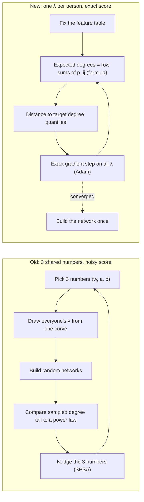
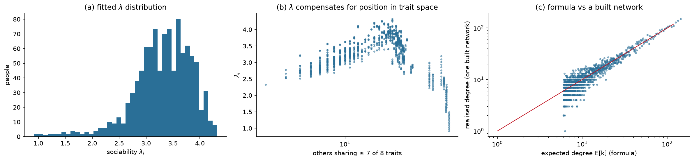
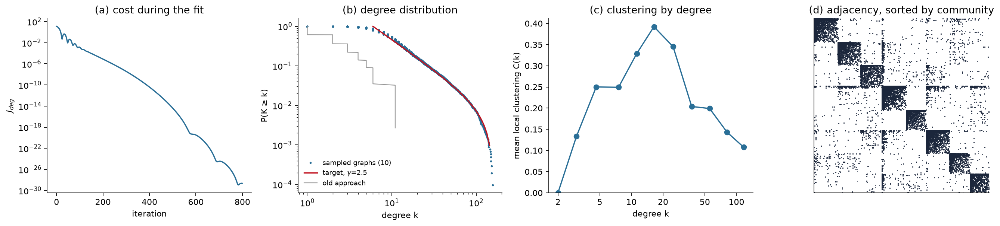
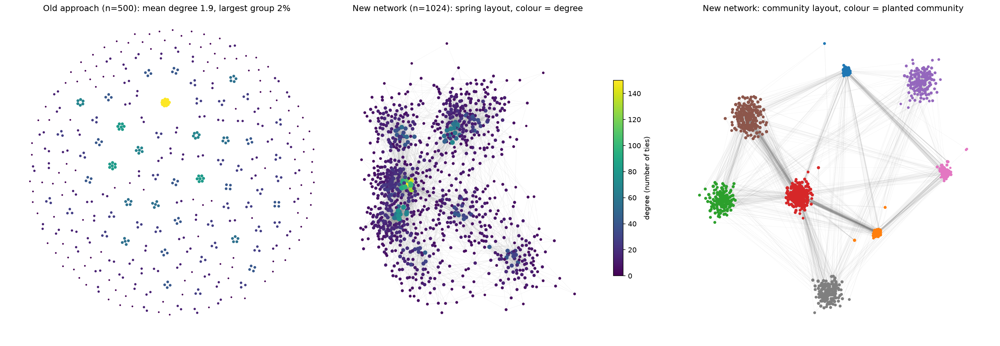
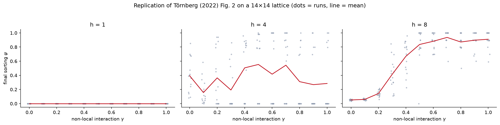
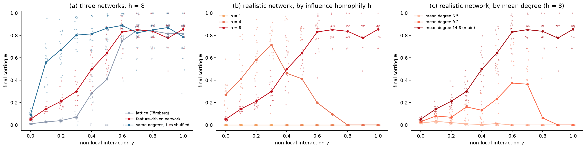
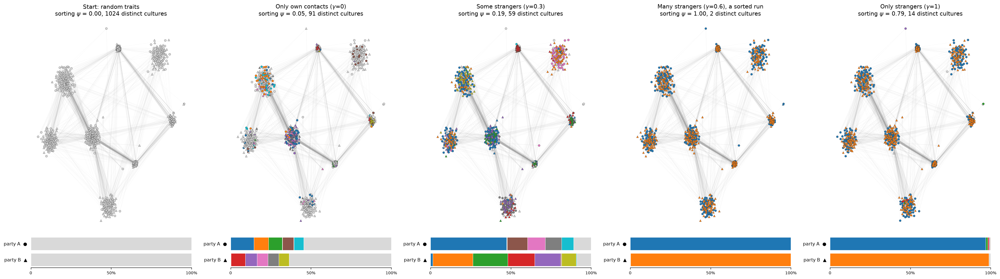

# Building a realistic social network: old vs new approach

*Companion explainer to [`01_feature_driven_network.ipynb`](../01_feature_driven_network.ipynb) (and the first half of [`02_tornberg_sorting.ipynb`](../02_tornberg_sorting.ipynb)).*

## In short

The new approach builds a network that looks like a real social network; the old one built a network that mostly fell apart. With the old settings the average person had about 2 friends and the largest connected group held about 2% of people. With the new settings the average person has about 14 friends (Dunbar's "sympathy group"), a few people have close to 150, everyone is reachable from everyone else in about 3 steps, and friends of friends are often friends.

The network model itself did not change. What changed is how its settings are chosen:

- **Old:** pick 3 numbers that describe how "sociable" people are on average, build random networks, compare them to the target, nudge the 3 numbers, repeat.
- **New:** give every person their own sociability number, and calculate exactly (no random networks) how far the expected friend counts are from the target. Then let a standard optimiser adjust all the numbers at once. Clustering and communities are set separately, by choosing how people's characteristics are generated.

This document explains the model, both ways of tuning it, and what each produces. Section 6 then summarises what the polarisation simulation does on the new network.

## 1. The model in plain words

The feature-driven graph model (Băbeanu) builds friendships from two things: what people are like, and how sociable they are.

1. **Characteristics.** Every person gets a short list of characteristics, for example 8 of them, each with 3 possible values. Think of answers to survey questions: neighbourhood, taste in music, religion, and so on.
2. **Similarity.** For any two people, count the share of characteristics they have in common. Two people who match on 6 of 8 have similarity 0.75.
3. **Sociability.** Every person gets a number λ (lambda). A **small** λ means very sociable: this person befriends even quite different people. A **large** λ means picky: they only befriend near-copies of themselves.
4. **Friendship.** Two people become friends with a probability that rises with their similarity and falls with both of their λ's:

```math
p_{ij} = s_{ij}^{\lambda_i \lambda_j}
```

Here s is the similarity (between 0 and 1). Raising a number below 1 to a bigger power makes it smaller, so picky people (big λ) get fewer friends. Every pair is decided by its own coin flip, independently of the others.

The model has two kinds of settings to tune: **how characteristics are generated** (how many there are, how many values each has, how strongly groups share them) and **the λ's**. This is the whole problem: choose these settings so that the network that comes out looks like a real social network.

## 2. What "realistic" means here

Real social networks share four well-known features. Each is a number we can measure on a network.

| Property | Plain meaning | How it is measured | Rough target |
| --- | --- | --- | --- |
| Heavy-tailed degrees | Most people have a handful of friends; a few have very many | The share of people with at least k friends falls roughly like a straight line on log–log axes | Slope matching an exponent of 2.5; friend counts from 6 to 150 |
| High clustering | Your friends are often friends with each other ("triadic closure") | Average clustering: of all pairs of a person's friends, the share who are themselves friends | Around 0.3, far above a random network |
| Short paths | Anyone reaches anyone in a few steps ("six degrees") | Average number of steps between two people | A handful, close to a random network |
| Communities | Dense groups with fewer ties between groups | Modularity: how much denser ties are inside groups than chance would give (0 = no groups) | Clearly above 0.3 |

Two more checks keep the network usable. **Connectedness:** the largest connected group should contain nearly everyone. **Mean degree:** about 14 friends per person (justified below).

A useful baseline is a random network with the same number of ties (an "Erdős–Rényi" graph). It has short paths, but almost no clustering, no communities and no hubs. A real network keeps the short paths and adds the other three.

### Why about 14 ties per person

A tie in this model is a person you talk to regularly enough to pick up everyday cultural traits from: where to eat, what to drive, what to watch. That is broader than a political discussion network but narrower than everyone you know. The closest layer in the research on personal networks is Dunbar's sympathy group of about 15.

| Layer of personal networks | Typical size | Source |
| --- | --- | --- |
| Core discussion network ("people you discuss important matters with") | 2.9 in 1985, 2.1 in 2004 (US mean) | [McPherson, Smith-Lovin & Brashears 2006](https://scholars.duke.edu/publication/914567) |
| Political discussion network | Very close to the core discussion network; survey name lists usually allow 3–6 names | [Klofstad, McClurg & Rolfe 2009](https://researchonline.lse.ac.uk/id/eprint/38619) |
| Support clique / sympathy group / wider layers | about 5 / 15 / 50 / 150 | [Zhou, Sornette, Hill & Dunbar 2005](https://pmc.ncbi.nlm.nih.gov/articles/PMC1634986/) |
| Törnberg's lattice (for comparison) | 8 neighbours | [Törnberg 2022](https://www.pnas.org/doi/10.1073/pnas.2207159119) |

Three reasons not to use the political discussion size of 2 to 3:

- **Traits are cultural, not only political.** Törnberg's sorting is about lifestyle traits becoming partisan, and people infer others' politics from everyday, non-political posts ([Settle 2018](https://www.cambridge.org/core/books/frenemies/how-do-end-interactions-on-the-news-feed-psychologically-polarize-users/370EB372594F06837169BFF9BB28E87F)). The relevant network is the one culture flows through.
- **A network of 2–3 ties per person falls apart.** It would have no large connected group, so there would be no society-wide dynamics to study.
- **Comparability.** Törnberg's lattice gives everyone 8 neighbours; a heavy-tailed network with a mean of 14 still has many people with 6 to 8 ties, so the bulk of people are comparable.

The chosen mean of about 14, with nobody above 150 (Dunbar's number), matches the sympathy-group layer. Everyone has at least about 6 ties, close to the support clique of about 5. An earlier version used a mean of 10; section 6 shows the choice matters a great deal, so it is tested rather than assumed.

## 3. The old approach

The old approach tuned 3 numbers by trial and error on randomly built networks, and every setting it ended on produced a network that had fallen apart.

**How the network was built.** 500 people, 10 yes/no characteristics, 2 groups. Each person copied 5 of their 10 characteristics from their group's template and drew the rest at random. Every person's λ was drawn from the same curve, whose shape was set by 3 numbers (w, a, b): λ values become more likely up to w, then less likely beyond it.

**How the settings were tuned.** The method is called SPSA. Each round:

1. Nudge all 3 numbers a little, once up and once down, in a random direction.
2. At each of the two nudged settings, draw λ's, build 3 random networks and score them.
3. Move the 3 numbers towards whichever side scored better. Repeat 200 times.

**The score.** Take every friend count of 5 or more in the built networks, and compare it with friend counts drawn from a power law starting at 5 (a distance between the two sets of numbers). Add two small penalties: one for very spread-out λ's, one for people outside the largest connected group. If fewer than 30% of people have 5 or more friends, the score is simply 1,000,000.

**What went wrong.** The notebook re-scores the old settings 15 times each:

| Setting (w, a, b) | Score (mean ± spread) | Mean friends per person |
| --- | --- | --- |
| Starting guess (3.0, 2.48, 1.36) | 8.5 ± 1.4 | 17.6 |
| Starting guess after one nudge | 4.7 ± 1.3 | 7.8 |
| Recorded result (5.0, 2.48, 1.36) | 1,000,000 every time | 3.0 |
| Recorded result (5.02, 4.03, 0.81) | 1,000,000 every time | 2.4 |
| Setting used to build the network (11.34, 0.66, 0.36) | 1,000,000 every time | 2.0 |

Four problems follow from this:

- **A cliff in the score.** Once networks get too sparse, the score is stuck at 1,000,000. Nudging the numbers changes nothing there, so the method gets no direction to move in. Every recorded result sits on that plateau.
- **No anchor for the average.** Comparing only the tail (5 friends or more) never says how many friends the *average* person should have. One small nudge moved the average from 17.6 to 7.8.
- **Noise.** Building random networks makes the score itself random: the same setting scores 8.5 one time and 7 or 10 another. The spread is about as big as the effect of a nudge.
- **Too few dials.** A person's friend count depends on their λ *and* on how many similar people exist. One shared curve for everyone cannot account for the second part.

The network built with the final setting has an average of 2 friends per person, a largest connected group of 2% of people and a busiest person with 11 friends. Its clustering and path-length numbers look good only because they are measured on that tiny group of about 12 people.

## 4. The new approach

The new approach splits the job in two: the λ's set how many friends each person has, and the characteristics set who clusters with whom. Each part is tuned with the tool that suits it.



The old loop spends its effort building random networks and gets a noisy score back. The new loop needs no networks until the very end, because its score is a formula.

### 4a. Friend counts: one λ per person, tuned by gradient descent

**Key idea: no random networks are needed to score a setting.** Because every friendship is its own coin flip, a person's *expected* number of friends is just the sum of their friendship probabilities. That is an exact calculation, so the same setting always gets the same score.

**The score.** 1,024 people means 1,024 expected friend counts. Sort them from lowest to highest. Make a target list of 1,024 friend counts from the power law (also sorted). Compare them position by position: the least sociable person with the lowest target value, and so on up to the biggest hub. The score is the average squared gap, measured on a log scale:

```math
J = \frac{1}{n} \sum_{r=1}^{n} \left( \log \bar{k}_{(r)} - \log k^{*}_{(r)} \right)^2
```

Here k̄ is the expected friend count, k\* the target and r the position in the sorted list. Three choices matter:

- **Sorting** means the score only cares about the overall distribution, not which person becomes a hub. The optimiser decides that, usually picking people with many similar others.
- **The log scale** makes a hub that is 20% off cost the same as a quiet person who is 20% off. Without it, the score would be dominated by the hubs.
- **The full list** fixes the average as well as the tail, so the network cannot drift into being too sparse.

**The tuning.** Because the score is an exact formula, we can also calculate exactly which direction each λ should move to lower it (its gradient). The optimiser (Adam, a standard variant of stochastic gradient descent) moves all 1,024 λ's at once, 800 times. This takes about 20 seconds, and the score falls to below 0.0000000000000000001: the expected friend counts match the target essentially perfectly. Section 4a″ below walks through the procedure step by step.

This is the same logic as fitting a regression by least squares rather than guessing coefficients. With 1,024 people it is cheap enough to use every person in every step; for much bigger networks one would use a random subset of people per step, which is stochastic gradient descent in the strict sense.

### 4a′. The maths step by step: how a friend count is computed without building the network

The expected friend count *does* depend on a specific feature table; what it does not need is a built network. The order is:

1. **Draw the feature table once.** Choose the recipe (number of characteristics F, values per characteristic q, communities C, characteristics copied from the community template D) and draw every person's vector. From now on this table is fixed.
2. **Compute all similarities.** For every pair, sᵢⱼ = share of characteristics they have in common. This is an n × n table of numbers between 0 and 1.
3. **Write down every tie probability.** For any choice of λ's, pᵢⱼ = sᵢⱼ^(λᵢλⱼ). This is still just arithmetic on the fixed table.
4. **Add them up.** A person's friend count is a sum of independent yes/no coin flips, one per other person. The expected value of a sum is the sum of the expected values, and the expected value of a coin flip that comes up 1 with probability p is p:

```math
\mathbb{E}[k_i] = \sum_{j \neq i} p_{ij}, \qquad \operatorname{Var}[k_i] = \sum_{j \neq i} p_{ij}(1-p_{ij})
```

So once the table is fixed, the expected friend count is an exact formula in the λ's. Building a network would only add coin-flip noise around it (a "Poisson-binomial" spread, given by the variance above).

**Worked example from the actual network.** A typical person has λ = 3.15 and no exact copies among the other 1,023 people. With a typical partner (λ about 3.4) their pair exponent is about 11. The table adds up their probabilities, averaged over the actual partners in each row:

| Characteristics shared (of 8) | Others like this | Average tie probability | Adds to expected friends |
| --- | --- | --- | --- |
| 8 (identical) | 0 | 1 | 0 |
| 7 | 9 | 0.26 | 2.3 |
| 6 | 46 | 0.13 | 5.8 |
| 5 | 114 | 0.009 | 1.0 |
| 4 or fewer | the other 854 | close to 0 | 0.4 |
| **All** | **1,023** |  | **9.5** |

So this person's expected friend count is 9.5, with a coin-flip spread of about ±3. The biggest hub has λ = 0.92, so its pair exponents are only about 2 to 4. Its 12 identical others are certain ties. Of the 70 people who differ on one characteristic, about two-thirds become friends, and so do 40% of those who differ on two. That adds up to 144 expected friends. Across all 1,024 people, the formula and a built network correlate at 0.98. They differ by 2.2 friends on average, about the size of the coin-flip noise the formula predicts (2.8).

### 4a″. How the λ's are chosen, step by step

**Short answer: nobody draws them.** There are no random starting values and no distribution function. Each person has their own λ, a free number like a coefficient in a regression. Gradient descent adjusts all 1,024 of them together until the expected friend counts match the target list. The λ distribution is an *output* of this procedure, not an input.

1. **Fix the feature table and the similarity table** (steps 1–2 of 4a′). They do not change during the fit.
2. **Make the target list.** Take the power law with slope γ = 2.5 between 6 and 150 friends, and read off 1,024 evenly spaced values from it (its quantiles). The r-th target is the friend count that has a share (r − ½)/1,024 of the distribution below it. The lowest target is 6, the median 9.5, the mean 14.5 and the highest 144. This is just the inverse of the power law's cumulative distribution:

```math
k^{*}_{(r)} = \big[a + (b-a)\,u_r\big]^{1/(1-\gamma)}, \qquad a = 6^{\,1-\gamma},\; b = 150^{\,1-\gamma},\; u_r = \frac{r - \tfrac12}{n}
```

3. **Start everyone at the same value, λ = 1.** The optimiser works with θ = ln λ, so this is θ = 0. There is no randomness here. At λ = 1 a tie probability is just the similarity (pᵢⱼ = sᵢⱼ), so everyone has far too many expected friends: between 281 and 493, 389 on average. At this point people differ only by where they sit in the feature table.
4. **Compute, sort and pair up.** Compute every person's expected friend count k̄ᵢ (the sum of their probabilities, 4a′). Sort the 1,024 counts and pair each person with the target at their rank. Their gap is rᵢ = ln k̄ᵢ − ln k\*. A positive gap means too many friends, a negative gap too few.
5. **Work out each person's gradient.** A person's λ moves their own friend count, and also the friend count of everyone they might be tied to, because a tie counts for both people. The chain rule gives, for person m,

```math
\frac{\partial J}{\partial \theta_m} = \sum_{j} \big(g_m + g_j\big)\, p_{mj} \ln p_{mj}, \qquad g_i = \frac{2\, r_i}{n\, \bar k_i}
```

pᵢⱼ ln pᵢⱼ is always negative (raising λ lowers every tie probability). So in words: if you and the people you are likely to be tied to have too many friends, your λ goes up (pickier); if too few, it goes down (more sociable).

6. **Take a small step.** Adam moves every θ against its gradient, with step size 0.05: θ ← θ − 0.05 × (running average of the gradient ÷ its typical size). Because Adam divides by the typical size, each person's λ changes by at most about 5% per step, whatever the scale of their gradient.
7. **Repeat 800 times.** Each step re-sorts, so the pairing of people with target ranks can change along the way. That is how the hubs are chosen: nobody is labelled a hub in advance.

**What the fit looks like.** These numbers come from re-running the final fit of notebook 1. It reproduces the saved λ's exactly, because nothing in it is random.

| Step | Score J | Mean expected friends | Fewest – most | λ: 5% / median / 95% |
| --- | --- | --- | --- | --- |
| 0 | 12.7 | 389 | 281 – 493 | 1.00 / 1.00 / 1.00 |
| 5 | 9.4 | 236 | 153 – 322 | 1.28 / 1.28 / 1.29 |
| 20 | 0.42 | 22.6 | 8 – 54 | 2.63 / 2.70 / 2.75 |
| 50 | 0.015 | 14.5 | 5 – 84 | 2.50 / 3.22 / 3.64 |
| 100 | 0.0014 | 14.5 | 6 – 119 | 2.44 / 3.29 / 3.96 |
| 200 | 0.000008 | 14.5 | 6.0 – 142 | 2.34 / 3.36 / 4.05 |
| 800 | ≈ 0 | 14.5 | 6.0 – 144 | 2.33 / 3.36 / 4.06 |

The fit runs in two phases. In the first 20 or so steps all λ's rise together, from 1 to about 2.7: that fixes the overall density. After that they spread out. Future hubs move down towards 0.9 while everyone else moves up to between 2.3 and 4.3. That shapes the tail: the most sociable person's expected count climbs from 54 to 144 while the mean stays at 14.5.

**Why one λ per person and not a distribution function.** The old approach drew λ's from a 3-parameter curve. That cannot work well here: the same λ gives someone with 50 near-copies in the feature table many more friends than someone with 2. A free λ per person can correct for each person's position, and with 1,024 λ's for 1,024 targets the match is exact. The price is that the λ's belong to this particular feature table. A new table needs a new fit, which takes seconds.

**Not tested.** The score only fixes the *sorted* list of friend counts. A different starting point (for example random λ's) could therefore end with different people as hubs, with the same degree distribution. We always start from λ = 1, so this has not been checked.

**The λ distribution this produces.** The 1,024 fitted λ's are themselves a distribution: 5% are below 2.3, the median is 3.4, 95% are below 4.1, and a tail of hubs reaches down to about 0.9. It is not drawn from a hand-chosen curve; it is whatever this feature table needs. Up to a point, people with more near-identical others get a *larger* λ, so that they do not end up with too many friends. The people with the very most near-identical others go the other way: the fit makes them the hubs, because they reach a hub's friend count most easily. Notebook 1 (section 1.7d) plots this.



Left: the fitted λ's. Middle: each person's λ against how many others share at least 7 of their 8 characteristics. Right: the expected friend count from the formula (x) against the friend count in one built network (y); the red line is where they would be equal.

**One limit worth knowing.** Two people who are identical on every characteristic have similarity 1, and 1 to any power is 1. They are therefore always tied, whatever their λ. This is why the feature recipe, not λ, sets the minimum amount of clustering.

**On names.** Băbeanu writes the pair exponent as hᵢⱼ = λᵢλⱼ. To avoid confusion with Törnberg's h (influence homophily), this project calls λᵢ the *sociability parameter* and λᵢλⱼ the *pair exponent*. "h" always means Törnberg's h.

### 4b. Why clustering is not in that score

I tried adding "expected clustering" to the score. The optimiser found a cheat: it made the hubs friends with each other. That raises one clustering measure, but it is not how real friend groups look:

- the tendency of popular people to befriend popular people jumped from about 0 to about 0.5, far above real social networks;
- communities got weaker (modularity fell from 0.73 to 0.32);
- the friend-count fit got worse;
- the *average* person's clustering barely moved.

The reason is simple. All 1,024 λ's are already used up to match 1,024 friend counts. Whatever clustering is left is decided by the characteristics: who is similar to whom.

### 4c. Clustering and communities: choosing how characteristics are generated

People in the same community copy part of their characteristics from a shared template. Fewer, coarser characteristics and stronger templates mean more near-identical people. Near-identical people are likely to all befriend each other, which closes triangles.

So the outer step is a small search. 16 combinations were tried: 6, 8, 10 or 14 characteristics; 3 or 4 values each; half or three quarters of characteristics copied from the template; always 8 communities. For each, the inner fit from 4a runs, two networks are built, and they are scored on three things:

- average clustering, aiming for about 0.35;
- modularity, aiming for about 0.6;
- the share of people outside the largest connected group, which should be close to zero.

The best combination is **8 characteristics with 3 values each, 6 of the 8 copied from the community template**. These targets are judgement calls based on typical social networks, not facts.

**Clustering is set by the feature table, as in Băbeanu's session 6.** The main dial is D, the number of characteristics each person copies from their community's template. More copying means more near-identical people inside each community, which means more closed triangles and denser communities. The λ's cannot change this; they only decide how many of those near-identical people each person actually befriends.

**One difference from the session-6 recipe.** In session 6 the number of values per characteristic equals the number of communities, and community c's template has value c on every characteristic, so no two templates share anything. Here the templates are drawn at random from 3 values, so communities overlap on some characteristics: a church community and a workplace community can share tastes. This is meant to capture cross-cutting similarity between communities. The session-6 version is a one-line change if you prefer to stay exactly with it.

## 5. Results side by side

The new network has about 5 times the clustering of a random network with exactly the same friend counts, and three times its modularity, while paths stay short.

| Network | Mean friends | Most friends | Avg. clustering | Avg. path (steps) | Modularity | In largest group |
| --- | --- | --- | --- | --- | --- | --- |
| New feature-driven network (average of 10 builds) | 14.5 | 147 | 0.29 | 3.2 | 0.70 | 100% |
| Same friend counts, ties shuffled (configuration model) | 14.2 | 129 | 0.05 | 2.8 | 0.23 | 100% |
| Same number of ties, fully random (Erdős–Rényi) | 14.6 | 26 | 0.02 | 2.9 | 0.23 | 100% |
| Old approach, final setting (500 people) | 1.9 | 11 | not meaningful | not meaningful | not meaningful | 2.4% |

How to read the comparison rows:

- **Shuffled ties** keep every person's friend count but connect people at random. The gap between this row and the first row is what the characteristics add: clustering 0.29 vs 0.05, modularity 0.70 vs 0.23.
- **Fully random** shows what you get with no hubs at all: nobody has more than 26 friends.
- **Paths** are a little longer in the new network (3.2 vs about 2.8). Clustered friend groups create some detours, but about 3 steps is still a small world.
- **The 10 builds** vary very little (clustering ±0.004, modularity ±0.004), so these numbers are stable.

### How dense are the communities, and who are the hubs?

The 8 communities are dense inside and only loosely tied to each other:

| Measure | Value |
| --- | --- |
| Share of all ties that stay inside a community | 84% |
| Ties inside a community: share of possible pairs that are tied | 7% to 14% (1 in 7 to 1 in 15) |
| Ties between communities: share of possible pairs that are tied | 0.27% (about 1 in 370) |
| Average clustering inside a community | 0.24 to 0.53 |

**Hubs are brokers, but mostly insiders.** In Burt's terms, a broker is someone whose contacts are not connected to each other, so they span "structural holes". Burt's *constraint* measures the opposite: high constraint means all your contacts know each other.

| Contacts | People | Ties outside own community | Communities reached | Burt's constraint |
| --- | --- | --- | --- | --- |
| 5 or fewer | 118 | 19% | 1.6 | 0.28 |
| 6–10 | 431 | 20% | 2.0 | 0.16 |
| 11–20 | 321 | 13% | 2.0 | 0.11 |
| 21–40 | 100 | 10% | 2.4 | 0.07 |
| More than 40 | 54 | 18% | 4.8 | 0.04 |

The biggest hubs reach almost 5 of the 8 communities and have the lowest constraint, so they sit across structural holes. But 82% of their ties are still inside their own community: they bridge by sheer volume, not by being outsiders.

**Do hubs know many people across party lines?** In this model everyone does, hubs included: party is assigned at random and plays no role in who befriends whom, so about half of anyone's ties cross the party line. Real networks are less mixed; on Facebook, a little over a fifth of an average user's ideologically identified friends are on the other side ([Bakshy, Messing & Adamic 2015](https://doi.org/10.1126/science.aaa1160)). This is listed as a point of contention in section 7.

### How to read the figures

Each figure follows its reading guide. Both come from notebook 1.

**Figure A: the fit (four panels).**

1. *Cost during the fit.* The score on a log scale against optimiser step. It drops from about 10 to below 0.0000000000000000001: the fit converges to the limit of computer precision.
2. *Degree distribution.* For each friend count k: the share of people with at least k friends, both axes on log scale. A heavy tail shows up as a line that falls slowly and roughly straight. Blue dots (10 built networks) sit on the red target line. The grey line (old approach) stops at 11 friends.
3. *Clustering by degree.* Average clustering of people with about k friends. People with 10 to 20 friends sit in the tightest groups. Hubs (50 or more friends) have low clustering because their friends come from many different groups.
4. *Adjacency matrix.* Every dot is a friendship between the person on that row and the person in that column. People are ordered by community, so the dense squares along the diagonal are the 8 communities. The scattered dots outside them are ties between communities, and the horizontal and vertical lines are hubs.



**Figure B: the network drawn.**

- *Left:* the old approach's network. Most people have zero to two friends, so the picture is mostly scattered dots. The only dense spots are small cliques of near-identical people; the largest holds 12 people. Colours are scaled per panel, so yellow here means 11 friends, not 100.
- *Middle:* the new network, each person sized and coloured by friend count. Bright, large nodes are hubs.
- *Right:* the same network with each community in its own colour, communities laid out apart. Each community is dense inside and joined to the others mainly through hubs.



## 6. What the polarisation model does on the new network

On the realistic network, more contact with strangers leads to more partisan sorting, as Törnberg found, provided people have enough contacts. With about 14 contacts each, sorting rises steadily with γ. With about 9 it rises and then collapses. With about 6 it never happens.

### The sorting model in one paragraph

Every person has a party (fixed, A or B, assigned at random so that every community contains both parties) and 10 cultural traits (each with 10 possible values) that can change. Repeatedly, a random person picks someone to talk to and copies one of that person's traits. They strongly prefer people like themselves, especially fellow partisans; how strongly is Törnberg's influence homophily h. "Sorting" ψ (psi) measures how much more similar people are to their own party than to the other party: 0 means culture has nothing to do with party, about 0.8 means each party has its own culture.

### The network's characteristics only build the network

The 8 characteristics that built the network (Băbeanu's features: think workplace, church, school) only decide **who is tied to whom**: the offline social network. The sorting model gives everyone a separate set of 10 cultural traits that start at random. This is Törnberg's clean sheet, which he uses on every network in his paper. So the network shapes opinions only by deciding who can talk to whom offline, and γ adds online contact on top. A variant that seeded opinions from the communities was tested and dropped.

### How "talking to strangers" works in the model

No ties are added and the network never changes. In each conversation, a share γ (gamma) of the person's contacts is swapped, for that one conversation only, for people drawn at random from the whole population. So γ is the share of conversations that are with random strangers, Törnberg's stand-in for internet contact.

Törnberg's code rounds γ × (number of contacts) down. On his grid everyone has 8 contacts, so this barely matters. On a realistic network many people have 4–6 contacts, and at γ = 0.1 almost half of them would never meet a stranger at all. The new code rounds up or down at random, so that everyone meets strangers in a share γ of their conversations on average.

One clarification on mechanism: in this model people never react *against* strangers. They simply ignore people who are too different. Sorting happens because strangers widen the pool of possible role models, so people can copy fellow partisans from anywhere rather than their neighbours of either party.

### Checking the code against Törnberg

On his exact set-up (a 14 × 14 grid of 196 people, his rounding), the code reproduces his three cases:

- **h = 1:** no sorting at any γ.
- **h = 4:** runs end either clearly sorted or not at all, roughly half each.
- **h = 8:** almost no sorting up to γ = 0.2, then a sharp rise; from γ = 0.4 nearly every run ends sorted.



### Results on the realistic network (h = 8)

| Network | Mean contacts | Share of runs sorted at γ = 0.3 / 0.5 / 1 | Sorting ψ when everyone talks only to strangers (γ = 1) |
| --- | --- | --- | --- |
| Törnberg's grid (1,024 people) | 8 | 0% / 41% / 94% | 0.81 |
| Realistic network (main) | 14.6 | 44% / 100% / 100% | 0.85 |
| Same contacts, ties shuffled | 14.6 | 94% / 100% / 100% | 0.79 |
| Realistic network, fewer ties | 9.2 | 6% / 38% / 0% | 0.00 |
| Realistic network, fewest ties | 6.5 | 0% / 0% / 0% | 0.00 |

What this says:

- **The answer to "does more internet contact mean more sorting?" is yes**, on the main network, and it happens earlier than on Törnberg's grid. Hubs and short paths spread party cultures faster than a grid does.
- **Close friend groups slow sorting down.** With the ties shuffled, almost every run is sorted already at γ = 0.1. Tight communities keep local cultures alive longer, so more contact with strangers is needed before culture lines up with party. This fits your intuition that a life lived more through close friend groups protects against sorting.
- **How many contacts people have matters most.** On test networks where everyone has exactly 4 contacts, sorting never happens even at γ = 1; with 6, three quarters of runs sort; with 8 or more, all do. My reading, not yet tested directly: a person with very few conversation partners often finds no fellow partisan among them, copies from the other side, and so ties the two parties' cultures together.
- **Influence homophily matters too.** At h = 1 nothing sorts. At h = 4 sorting appears at moderate γ (peaking at ψ = 0.71 at γ = 0.3) but gives way to one shared culture once γ ≥ 0.8. Strong homophily (h = 8) is needed for sorting to survive heavy contact with strangers.



How to read it: each dot is one run and the line is the average. Left: the grid, the realistic network and the shuffled network. Middle: the realistic network at h = 1, 4 and 8. Right: the same people fitted to three mean numbers of contacts.

**Reading the end-state drawing** (inserted below). Shape = party, colour = culture, and the bars underneath show what share of each party holds each culture:

- **Only own contacts:** small same-party groups each settle on a local culture. Each party is split into many cultures that vary from place to place, so a fellow partisan elsewhere is no more like you than an opponent (ψ ≈ 0).
- **More strangers:** each party converges on one culture across the whole network. Each bar becomes almost one colour, a different one per party.



## 7. Limitations, points of contention and glossary

**Limitations.**

- **Expected, not exact, friend counts.** The fit matches the *expected* number of friends. A real build adds some randomness, which matters most for people with very few friends.
- **Short tail.** With 1,024 people, friend counts only span 6 to about 150. That is enough to be clearly heavy-tailed, but not enough to test a true power law.
- **Judgement-call targets.** The clustering (0.35) and modularity (0.6) targets come from typical social networks; different targets would pick a different recipe. The result overshoots on modularity (0.77).
- **One build.** Everything uses one draw of characteristics; the recipe search was not repeated with other random seeds.
- **Hubs are friendly to everyone.** A small λ makes a person befriend almost anyone, so hubs bridge all communities and have low clustering.
- **Fixed network.** In the sorting simulation, friendships never change as people's culture changes.

**Points of contention for future research.**

- **What "talking to strangers" stands for.** Random strangers swapped in per conversation are a crude stand-in for internet use. Real online contacts are mostly existing or weak ties, filtered by homophily and by algorithms. A better version would draw online contacts with a preference for similar or nearby people, or from a second, online layer of ties.
- **What a tie is, and how many there are.** The sorting result depends strongly on the mean number of contacts (about 6, 9 or 14). About 14 rests on Dunbar's sympathy group, but political discussion networks are much smaller (2–3 people).
- **Party is independent of community.** This keeps communities cross-cut by party, as in Törnberg. But real communities lean one way, and most ties stay within a party. Correlating party with community is a natural next step.
- **No negative reaction.** People ignore dissimilar others but are never pushed away by them. Adding repulsion would make strangers polarising in a second way.
- **A fixed network.** Ties never respond to culture. In the feature-driven model ties come from similarity, so the network could be rebuilt as traits change; sorting would then rewire friendships.
- **The community recipe.** The templates here overlap across communities, unlike Băbeanu's session-6 version. Which better captures cross-cutting cleavages is open.
- **Size effects.** At h = 4 the outcome depends on system size (196 vs 1,024 people), so results at intermediate homophily should be checked at several sizes.

**Glossary.**

| Term | Meaning |
| --- | --- |
| Degree | Number of ties (friends) a person has |
| Heavy-tailed / power law | Most people have few ties, a small number have very many; the share with at least k ties falls like a power of k |
| Clustering | Share of a person's pairs of friends who are friends with each other |
| Modularity | How much denser ties are inside groups than random wiring would give; 0 = no groups |
| Path length | Number of steps along ties between two people |
| Configuration model | A random network that keeps every person's degree but shuffles who is tied to whom |
| Erdős–Rényi graph | A fully random network with a given number of ties |
| λ (lambda) | Sociability dial: small = befriends many kinds of people, large = picky |
| Cost function / score | A single number saying how far the network is from the target; lower is better |
| Gradient | For each dial, which way to turn it (and how hard) to lower the score fastest |
| SPSA | Tuning by random nudges and comparing two noisy scores; no exact gradient needed |
| Adam / gradient descent | Tuning by repeatedly turning every dial a little in the direction its gradient says |
| γ (gamma) | In the sorting model: share of contacts that are random strangers instead of own ties |
| ψ (psi) | Sorting: similarity to own party minus similarity to the other party |
