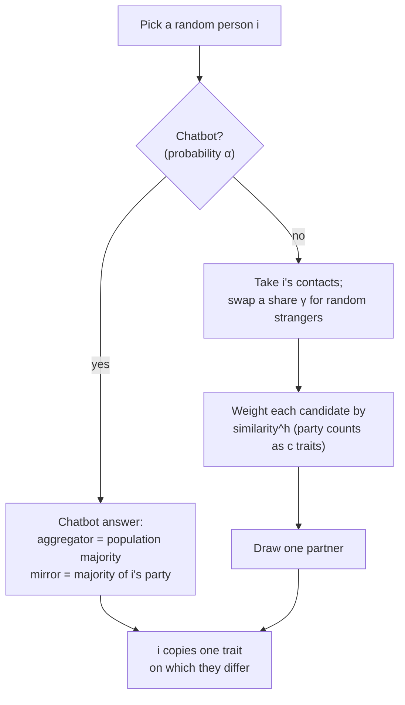
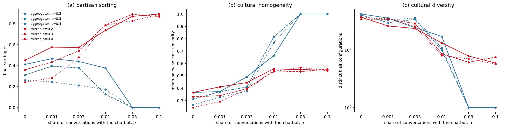
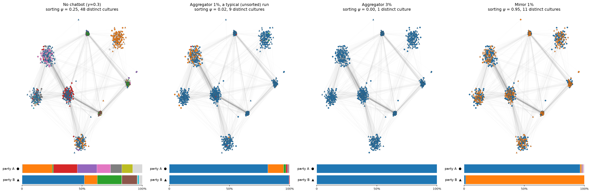

# Adding AI to the polarisation model: the aggregator and the mirror

*Companion explainer to §2.3 of [`02_tornberg_sorting.ipynb`](../02_tornberg_sorting.ipynb).*

## In short

At a realistic level of contact with strangers, a chatbot that tells each user what their own side thinks pushes a partly sorted society into two party cultures; a chatbot that gives everyone the same answer merges it into one culture. In the simulation, 1% of conversations with the first raises sorting from about 0.3 to about 0.8, and 3% of conversations with the second leaves a single culture.

**The question.** Törnberg (2022) argues that digital media polarise by putting us in touch with strangers from across society, not by trapping us in bubbles. Large language models (LLMs) are a new kind of contact: available to everyone, not a person, and built from what the whole population has written. How does that kind of contact change partisan sorting?

**The two chatbots modelled.**

- **The aggregator** answers every question with the most common view in the whole population. It stands for the well-documented tendency of LLMs to make what people write more alike.

- **The mirror** answers with the most common view among the user's own party. It stands for sycophancy (models telling users what they already believe) and personalisation.

Both are deliberately simple, extreme versions of real tendencies; real systems sit somewhere between them. Section 3 explains why these two were chosen, with the research behind each.

## 1. Background: Törnberg's sorting argument

Törnberg's claim is that polarisation grows when contact with distant strangers lines culture up with party, not when people retreat into echo chambers.

**Sorting, not just disagreement.** In the US, being a Democrat or a Republican increasingly comes bundled with where you live, what you eat, which church you attend and what music you like. When all these lines coincide, every cultural difference becomes a party difference, and dislike of the other side grows. Political scientists call this partisan sorting.

**The model** ([Törnberg 2022](https://www.pnas.org/doi/10.1073/pnas.2207159119)) builds on Axelrod's model of cultural dissemination ([Axelrod 1997](https://journals.sagepub.com/doi/10.1177/0022002797041002001)):

- Each person has a fixed party and 10 cultural traits that can change.

- Repeatedly, a person picks someone to talk to and copies one of their traits.

- They strongly prefer to talk to people similar to themselves, and fellow partisans count as extra similar.

- A share γ of their conversation partners are random strangers rather than neighbours. This stands for digital media.

**The result.** With only local contact, small groups of neighbours settle on their own local culture. Each party ends up split into many cultures that differ from place to place, so across society a fellow partisan is no more similar to you than an opponent, and culture and party do not line up. With lots of contact with strangers, the local cultures dissolve. People then pick their models from across the whole society, choose fellow partisans, and each party converges on its own culture. Exposure to the other side does not cure this; it is part of how it happens, which fits evidence that exposure to opposing views on social media can increase polarisation ([Bail et al. 2018](https://www.pnas.org/doi/10.1073/pnas.1804840115)).

**Why add AI.** In this framework, the most important thing about a communication technology is *who it connects you to*. A chatbot is a new answer to that question: one non-human contact that everybody shares.

## 1b. One conversation, step by step

A "conversation" in Törnberg's model is one person choosing one partner and copying one of that partner's traits. Nothing else happens: no argument, no change in party, no effect on the partner. Opinions change only by this one-trait copying, repeated many times.

### What each person has

- **A party**: A or B. It never changes. In our simulations it is assigned at random, so every community contains both parties.

- **10 cultural traits**, each with one of 10 values (think: car brand, cuisine, music genre, newspaper). These are the "opinions" and lifestyle choices that can change.

- **Contacts**: their ties in the [realistic network](01_realistic_network.md) (about 14 on average).

**Where these traits come from.** These 10 traits are not the characteristics that built the network. Those only decide who is tied to whom offline. The traits start at random, as Törnberg does on every network in his paper. The network shapes opinions only by deciding who can talk to whom offline.

Two fixed settings shape every conversation:

- **c = 4**, the party bonus: sharing a party counts as much as sharing 4 traits.

- **h = 8**, influence homophily: how strongly people prefer to learn from those most like them.

### Worked example

Ana belongs to party A. She has 4 contacts: Ben (A), Cleo (B), Dev (A) and Finn (B). Contact with strangers is γ = 0.25.

**Step 1: pick who has a conversation.** A person is drawn at random from the whole population; this time it is Ana.

**Step 2: build her list of possible partners.** Start from her 4 contacts. A share γ of them, here 0.25 × 4 = 1, is swapped for someone drawn at random from the whole population, for this one conversation only. Finn is swapped out and Eve, a stranger from another community who also votes A, is swapped in. The network itself does not change; next time Finn is back on the list.

**Step 3: score each possible partner by similarity.** Similarity = (party bonus if same party + number of shared traits) ÷ (4 + 10). Then raise it to the power h = 8, which strongly favours the most similar:

| Possible partner | Same party? | Traits shared with Ana | Similarity | Similarity^8 | Chance of being chosen |
|----|----|----|----|----|----|
| Eve (stranger) | yes | 9 | (4+9)/14 = 0.93 | 0.553 | 87% |
| Ben | yes | 6 | (4+6)/14 = 0.71 | 0.068 | 11% |
| Cleo | no | 8 | (0+8)/14 = 0.57 | 0.011 | 2% |
| Dev | yes | 3 | (4+3)/14 = 0.50 | 0.004 | 1% |

Two things to notice. Cleo shares more traits with Ana than Ben does, yet Ben is six times more likely to be chosen, because of the party bonus. And raising to the power 8 makes the most similar person dominate. With h = 1 the same four would get 34%, 26%, 21% and 18%: almost anyone could be chosen.

**Step 4: draw the partner.** A weighted random draw picks Eve (87% chance).

**Step 5: copy one trait.** Ana and Eve differ on exactly one trait, say music genre. Ana adopts Eve's value. Had they differed on several traits, one of them would be picked at random and only that one copied. Had they been identical, nothing would happen.

That is one conversation. Repeating it 1,024 times, once per person on average, is one "round"; a simulation runs 3,000 rounds.

### How sorting comes out of millions of these steps

- **Without strangers (γ = 0)**, Ana can only copy from her 4 contacts. Ben and Dev are local co-partisans, so she drifts towards *her neighbourhood's* party-A culture. Party-A members in other communities drift towards *their* local cultures. Party A ends up with many different cultures, one per place, and so does party B. Across society, culture does not line up with party.

- **With strangers (γ \> 0)**, every so often a highly similar co-partisan from elsewhere (an Eve) appears on the list, and the h = 8 weighting makes her the near-certain pick. Local party-A cultures start copying each other, and they merge into one party-A culture. The same happens in party B. Culture now lines up with party: this is partisan sorting.

- **Strangers who are too different are simply ignored.** The weighting gives them almost no chance of being chosen. Sorting does not come from reacting *against* the other side; it comes from a wider choice of whom to copy.

Without a chatbot (α = 0), every conversation takes the right-hand path. The chatbot adds the left-hand shortcut, which bypasses the partner list and the similarity scoring but ends in the same copying step.

### What the chatbot changes in that step

The chatbot changes only steps 2 to 4: *who* Ana talks to. The copying in step 5 stays exactly the same.

With probability α (for example 1% of conversations), Ana talks to her chatbot instead of building a list of people. The chatbot gives an answer on all 10 traits:

- **Aggregator:** for each trait, the value most common in the whole population right now.

- **Mirror:** for each trait, the value most common among members of *Ana's own party* right now.

Ana then copies one trait on which she differs from that answer, picked at random, as in step 5. Both answers are recalculated every round, so the chatbot keeps up with the society it learns from. The chatbot is never one of anyone's contacts and creates no ties.

**Continuing the example.** Suppose the aggregator's answer differs from Ana on 3 traits (cuisine, car, newspaper). She adopts one of them, say the most popular cuisine in the whole country. The mirror's answer is the typical party-A profile; if it differs from Ana on 2 traits, she adopts one of those.

|  | A contact | A stranger (γ) | Aggregator chatbot (α) | Mirror chatbot (α) |
|----|----|----|----|----|
| Who it is | One of Ana's ties | A random person from anywhere | The same machine for everybody | The same machine, tuned to Ana's party |
| Filtered by similarity (h)? | Yes | Yes | No, always used | No, always used |
| What Ana copies | That person's trait | That person's trait | The national majority value | Her party's majority value |
| Same target for everyone? | No | No, random each time | Yes, one target for all | One target per party |

These differences explain the results in section 4:

1.  **It skips the similarity filter.** In the worked example, a partner sharing only 3 of Ana's traits (Dev) had a 1% chance of being chosen. A chatbot whose answer is just as different is used every time it is consulted. So the chatbot reaches people that human influence, with strong homophily, rarely moves.

2.  **It is one partner shared by everyone.** Each human stranger is a random draw, pulling in a random direction. Every chatbot conversation pulls towards the *same* target, so even a small α adds up across 1,024 people.

3.  **The target decides the outcome.**

    - The **aggregator's** target ignores party, so both parties drift to the same culture. This undoes sorting and, at higher α, wipes out all variety.

    - The **mirror's** target is "the typical member of your party". It acts like an Eve, a perfectly representative co-partisan from elsewhere, who turns up every time. That is exactly the mechanism behind sorting in step 5, delivered directly and without needing contact with strangers. So the mirror sorts even societies where γ is low.

## 2. What the research says about AI in social influence

The evidence points two ways at once: LLMs make people's views and writing more alike, and they also tend to agree with whoever is using them.

### 2a. Machines as members of social networks

- **Machine behaviour.** [Rahwan et al. (2019)](https://www.nature.com/articles/s41586-019-1138-y) argue that AI systems should be studied like a new kind of actor, with methods from the behavioural and social sciences, because their effects come from interacting with people.

- **Human–machine networks.** [Tsvetkova et al. (2017)](https://dl.acm.org/doi/10.1145/3039868) survey networks where humans and machines both act (social media, crowdsourcing, online markets) and argue they cannot be understood as purely human or purely technical.

- **A few machines can change a whole group.** In [Shirado & Christakis (2017)](https://www.nature.com/articles/nature22332), about 4,000 people played a coordination game on networks of 20. Adding 3 bots that behaved slightly randomly, in central positions, made groups solve the task faster (median time 55.6% shorter), partly by changing how the humans interacted with each other.

### 2b. Chatbots as cultural models

[Brinkmann et al. (2023)](https://www.nature.com/articles/s41562-023-01742-2) call this "machine culture": machines now take part in how culture varies, spreads and gets selected. They list chatbots as a new kind of *cultural model*, someone (or something) people learn from. This is exactly the role a chatbot plays in an Axelrod-type model: a source of traits to copy.

### 2c. LLMs change what people think

| Study | What was done | What happened |
|----|----|----|
| [Jakesch et al. (2023)](https://arxiv.org/abs/2302.00560) | 1,506 people wrote about social media with an AI assistant set to favour one side | Their writing *and* their later survey answers moved towards the assistant's side ("latent persuasion") |
| [Hackenburg & Margetts (2024)](https://www.pnas.org/doi/10.1073/pnas.2403116121) | 8,587 people read GPT-4 messages, generic or tailored to their profile | Messages raised support by up to 12 points; tailoring added no significant extra effect |
| [Costello, Pennycook & Rand (2024)](https://www.science.org/doi/10.1126/science.adq1814) | 2,190 conspiracy believers had a short conversation with GPT-4 Turbo | Belief fell by about 20% and stayed lower after 2 months, even among people who distrust AI |
| [Hackenburg et al. (2025)](https://arxiv.org/abs/2507.13919) | About 77,000 UK participants in 91,000 AI conversations on political issues | Conversations persuaded more than static messages; the most persuasive models were the least accurate |

The common thread: one conversation with a chatbot moves people's views by measurable amounts, and people adopt what it says without treating it as an outsider.

### 2d. LLMs make content more alike

- [Doshi & Hauser (2024)](https://www.science.org/doi/10.1126/sciadv.adn5290): writers given story ideas from GPT-4 wrote stories rated as more creative, but the stories were more similar to each other. The authors call it a social dilemma: each person gains, the group loses variety.

- [Padmakumar & He (2024)](https://arxiv.org/abs/2309.05196): essays co-written with a feedback-tuned model (InstructGPT) were significantly less diverse than essays written alone, mainly because the model's own contributions were similar across writers.

### 2e. LLMs tend to agree with the user

- [Perez et al. (2023)](https://arxiv.org/abs/2212.09251): when a user states a political view, larger models are more likely to repeat it back. The authors name this "sycophancy".

- [Sharma et al. (2024)](https://arxiv.org/abs/2310.13548): five commercial assistants all showed sycophancy, including conforming to the user's beliefs. Part of the cause is that people rate agreeing answers more highly during training.

- [Santurkar et al. (2023)](https://arxiv.org/abs/2303.17548): models' opinions do not match the US public's average; the gap is as large as the gap between Democrats and Republicans on climate change. Models can be steered towards a group's views, but only partly.

Together, 2d and 2e describe two opposite pulls. A model trained on everyone's text pulls answers towards the typical; a model trained to please its user pulls answers towards that user.

## 3. Why these two chatbots

The aggregator and the mirror are the two ends of one design question: *does the chatbot's answer depend on who is asking?* The literature in section 2 documents a pull towards each end, and the two ends make opposite predictions for sorting, which makes the contrast informative.

### How a chatbot enters the model

The change to Törnberg's model is small, so that any difference in outcomes can be traced to the chatbot:

1.  Each time a person is due for a conversation, with probability α (alpha) they talk to the chatbot instead of a person.

2.  The chatbot gives an answer on all 10 traits. The person copies one trait on which they differ, exactly as they would from a person.

3.  The chatbot's answers are recalculated from the population after every round, so it keeps up with the society it learns from.

Three modelling choices, and why:

- **One chatbot that everyone can reach.** A few providers serve most users, so one shared contact is closer to reality than many separate bots. In network terms, it is a single node tied to everyone.

- **No "only talk to similar people" filter for the chatbot.** In Törnberg's model, people mostly ignore dissimilar others. The persuasion studies (2c) show people take up chatbot content even when they distrust AI or do not notice its slant, so the chatbot is not treated as an out-group member.

- **Copying one trait at a time.** This keeps the chatbot's influence per conversation the same as a person's. Any extra effect comes from its *position* (reachable by all, consistent answers), not from being more convincing.

### The setting: a personal assistant, not a bot in the crowd

The case modelled is people talking to *their own* chatbot: a private conversation with something they know is a machine. This is different from bots posing as people on social media, where it is unclear whether users see them as human. So the chatbot is an outside actor of its own kind, not one more node in the friendship network. That is why it is reached through its own channel (probability α), outside both the friendship ties and the stranger contacts.

### Testing at a realistic level of contact with strangers

Chatbots arrive in societies that already use social media, so the chatbot results are reported at γ = 0.2 to 0.4, not at γ = 0. There is no direct measurement of what share of everyday conversations are with strangers. The evidence points to a substantial minority:

- Most political and cultural talk still happens face-to-face, and people are more comfortable discussing politics in person than online ([Pew Research Center 2019](https://www.pewresearch.org/internet/2019/05/13/more-people-are-comfortable-discussing-politics-in-person-than-on-their-phones-or-via-social-media/)).

- Social network sites are mainly used to keep up with people known offline, not to meet strangers ([Ellison, Steinfield & Lampe 2007](https://doi.org/10.1111/j.1083-6101.2007.00367.x)).

- They do widen exposure: on Facebook, more than 20% of an average user's friends who state an ideology are on the other side ([Bakshy, Messing & Adamic 2015](https://doi.org/10.1126/science.aaa1160)). People also learn others' politics from everyday, non-political posts by weak ties ([Settle 2018](https://www.cambridge.org/core/books/frenemies/how-do-end-interactions-on-the-news-feed-psychologically-polarize-users/370EB372594F06837169BFF9BB28E87F)).

In the model, γ means *uniformly random* strangers, the most extreme kind of non-local contact. A realistic γ should therefore sit below the raw share of online interaction. The range 0.2–0.4 is also where the realistic network is partly sorted already, which is where a new influence can tip the outcome either way. This choice is a judgement, and it is listed as a point of contention in section 5.

### The aggregator

**What it does:** answers with the most common value of each trait in the whole population.

**Why:** LLMs are trained on text written by very many people, and studies find they pull writing and ideas towards the typical (Doshi & Hauser 2024; Padmakumar & He 2024). Brinkmann et al. (2023) describe chatbots as cultural models for everyone at once. The aggregator is the cleanest version of that: a voice of the majority, the same for every user.

**What it predicts:** a strong force towards one shared culture. That should reduce sorting, but at the cost of diversity.

**Simplification:** real models do not reflect the true population average (Santurkar et al. 2023). Using the actual majority is the most generous assumption for the aggregator; a skewed model would pull towards a different centre, not none.

### The mirror

**What it does:** answers with the most common value of each trait among the user's own party.

**Why:** models tend to agree with views the user states (Perez et al. 2023), including political ones, and this is partly built in by training on human approval (Sharma et al. 2024). A model that infers who you are and agrees with "people like you" is the mirror.

**What it predicts:** the mirror does the same job as Törnberg's strangers, but more efficiently. It brings every user a summary of their whole party, so local cultures should give way to party cultures even without contact with strangers.

**Simplification:** it knows each user's party perfectly. Real personalisation is noisier, and Hackenburg & Margetts (2024) found that tailoring messages to a profile did not add persuasive power. The mirror is about agreeing with the user's side, not about persuasion through tailoring, but this evidence is a reason to treat it as an upper bound.

### Alternatives not chosen (yet)

- **A chatbot with its own agenda** (always pushing one view). This is closer to the literature on bots and committed minorities, and answers a different question: manipulation rather than everyday use.

- **LLM agents as simulated people.** Useful for generating behaviour, but it replaces the humans in the model instead of adding a machine to a human network.

- **Mixing the two** (an answer partly from the population, partly from the user's party). This is the natural next step, and it turns the comparison into a dial (section 5).

## 4. Results

At a realistic level of contact with strangers (γ = 0.2–0.4), societies are already partly sorted (ψ = 0.24–0.45). A mirror chatbot handling 1% of conversations raises sorting to about 0.8. An aggregator at 3% merges everyone into one culture.

*From [`02_tornberg_sorting.ipynb`](../02_tornberg_sorting.ipynb), §2.3 · 12 runs per point.*

How to read it: each point is the average of 12 simulation runs on the realistic network (mean of about 14 contacts); line style = γ (0.2, 0.3, 0.4). The x-axis steps are uneven, from 0.1% to 10% of all conversations. Left: how much culture lines up with party. Right: how many different cultures survive.

**The aggregator: less sorting, less diversity.**

- At 0.1–0.3% of conversations it changes little.

- At 1% it pulls most societies towards one culture, but not all: at γ = 0.3, 7 of 12 runs end near consensus (ψ below 0.05) while the rest stay partly sorted.

- From 3% upward, every run at every γ ends with one culture shared by everybody (ψ = 0).

- It is the network version of Doshi & Hauser's social dilemma: each conversation pulls one person towards the middle, and together they remove all variety.

**The mirror: sorting without strangers.**

- At 0.3% of conversations sorting rises to about 0.5–0.57; at 1% to about 0.75–0.8; from 3% to about 0.85–0.9, at all three levels of γ.

- The effect is largest where contact with strangers alone sorts least: at γ = 0.2, sorting goes from 0.24 to 0.79 at 1%.

- It does not wipe out variety: 6–9 cultures survive, roughly one per party plus some local leftovers.

**Why so little is enough.** The chatbot is the only contact that every person shares, and it gives the same kind of answer every time. In network terms it is an outside hub tied to all 1,024 people, and its message never wavers. Whether that hub speaks to everyone with one voice (aggregator) or to each party separately (mirror) decides whether it erases differences altogether or aligns them with party. For reference, without any contact with strangers (γ = 0), the earlier version of this analysis found the same split: the mirror sorted a society that never meets strangers, and the aggregator collapsed it to one culture.

The network drawing below shows typical end states at γ = 0.3. Shape = party, colour = culture, and the bars underneath show what share of each party holds each culture. Without a chatbot, each party is split into several cultures. With the aggregator at 1%, a typical run ends near one shared culture; at 3%, always. With the mirror at 1%, each party shares one culture across the whole network, different from the other party's.

## 5. Limitations and next steps

The results show what the two extremes do, not how strong real effects are; each simplification below makes the chatbot's effect larger than it would plausibly be.

**Limitations.**

- **Instant learning.** The chatbot knows the current majority at every moment. Real models are trained on text that is months or years old.

- **Perfect personalisation.** The mirror always knows the user's party. Real inference is noisy, and tailoring has shown little extra persuasive power (Hackenburg & Margetts 2024).

- **Full trust.** People copy a trait from the chatbot as readily as from their closest match. The persuasion studies show real but partial effects, so a trust parameter is needed.

- **Everyone uses it equally.** Real adoption differs by age, education and community.

- **Few runs, fixed network.** 12 runs per point, one network, and friendships never change.

**Points of contention for future research.**

- **The realistic level of contact with strangers.** No study measures directly what share of everyday conversation is with strangers. The value γ = 0.2–0.4 is a judgement from indirect evidence (most political talk is face-to-face; social media mostly connects people who already know each other). A better approach would calibrate γ from time-use or contact-diary data, or model online contact as a second, homophilous layer of ties instead of random strangers.

- **How a chatbot is perceived.** The model assumes people know they are talking to a machine and do not filter its answers by similarity. Whether people trust their assistant more like a friend, like an expert or like a stranger is an open empirical question; a trust parameter would make this explicit.

- **What the chatbot knows about you.** The mirror infers party perfectly. Real assistants infer it from conversation history, with error, and providers may deliberately limit this.

- **Who uses chatbots.** Adoption is uneven by age, education and community, which could create new divides between users and non-users.

- **Mean degree.** On the network level, the sorting result itself depends strongly on how many contacts people have (see [the network explainer](01_realistic_network.md)). Chatbot effects should be re-checked at other plausible values.

**Next steps that connect to Vedres's work.** His research looks at how network position, overlapping groups and brokerage produce new ideas: "structural folds", where cohesive groups overlap ([Vedres & Stark 2010](https://www.journals.uchicago.edu/doi/10.1086/649497)), and "forbidden triads", open triangles between people who are tied to the same person but not to each other ([Vedres 2017](https://appliednetsci.springeropen.com/articles/10.1007/s41109-017-0051-2)). Both make the chatbot a natural object of study:

- **The chatbot as a universal broker.** It sits in every structural hole at once. What happens to human brokers when it arrives: does their influence on what spreads fall as α rises?

- **Overlapping groups.** In this model, people in two communities at once are where cultures meet. Does the aggregator make those overlaps irrelevant, and does the mirror turn them into party lines?

- **A dial instead of two ends.** Let the chatbot answer with a mix: a share from the whole population, the rest from the user's party. Find the point where it switches from reducing to increasing sorting.

- **Trust and adoption.** Add a similarity filter for the chatbot, and let adoption vary by community or by number of friends.

- **Lagged training.** Let the chatbot answer with the majority from some time ago. It then becomes an anchor to the past that may slow both sorting and convergence.

- **A changing network.** Because ties in the feature-driven model come from similarity, the network can be rebuilt as culture changes. Sorting would then rewire friendships, which is the step from cultural to social polarisation.

## References

- Axelrod, R. (1997). [The dissemination of culture: A model with local convergence and global polarization](https://journals.sagepub.com/doi/10.1177/0022002797041002001). *Journal of Conflict Resolution*, 41(2), 203–226.

- Bail, C. A., et al. (2018). [Exposure to opposing views on social media can increase political polarization](https://www.pnas.org/doi/10.1073/pnas.1804840115). *PNAS*, 115(37), 9216–9221.

- Bakshy, E., Messing, S., & Adamic, L. A. (2015). [Exposure to ideologically diverse news and opinion on Facebook](https://doi.org/10.1126/science.aaa1160). *Science*, 348(6239), 1130–1132.

- Brinkmann, L., et al. (2023). [Machine culture](https://www.nature.com/articles/s41562-023-01742-2). *Nature Human Behaviour*, 7(11), 1855–1868.

- Costello, T. H., Pennycook, G., & Rand, D. G. (2024). [Durably reducing conspiracy beliefs through dialogues with AI](https://www.science.org/doi/10.1126/science.adq1814). *Science*, 385.

- Doshi, A. R., & Hauser, O. P. (2024). [Generative AI enhances individual creativity but reduces the collective diversity of novel content](https://www.science.org/doi/10.1126/sciadv.adn5290). *Science Advances*, 10(28).

- Ellison, N. B., Steinfield, C., & Lampe, C. (2007). [The benefits of Facebook "friends": Social capital and college students' use of online social network sites](https://doi.org/10.1111/j.1083-6101.2007.00367.x). *Journal of Computer-Mediated Communication*, 12(4).

- Hackenburg, K., & Margetts, H. (2024). [Evaluating the persuasive influence of political microtargeting with large language models](https://www.pnas.org/doi/10.1073/pnas.2403116121). *PNAS*, 121(24).

- Hackenburg, K., et al. (2025). [The levers of political persuasion with conversational AI](https://arxiv.org/abs/2507.13919). *Science*, 390 (preprint linked).

- Jakesch, M., Bhat, A., Buschek, D., Zalmanson, L., & Naaman, M. (2023). [Co-writing with opinionated language models affects users' views](https://arxiv.org/abs/2302.00560). *CHI 2023*.

- Padmakumar, V., & He, H. (2024). [Does writing with language models reduce content diversity?](https://arxiv.org/abs/2309.05196) *ICLR 2024*.

- Perez, E., et al. (2023). [Discovering language model behaviors with model-written evaluations](https://arxiv.org/abs/2212.09251). *Findings of ACL 2023*.

- Pew Research Center (2019). [More people are comfortable discussing politics in person than on their phones or via social media](https://www.pewresearch.org/internet/2019/05/13/more-people-are-comfortable-discussing-politics-in-person-than-on-their-phones-or-via-social-media/).

- Rahwan, I., et al. (2019). [Machine behaviour](https://www.nature.com/articles/s41586-019-1138-y). *Nature*, 568, 477–486.

- Santurkar, S., et al. (2023). [Whose opinions do language models reflect?](https://arxiv.org/abs/2303.17548) *ICML 2023*, PMLR 202.

- Settle, J. E. (2018). [Frenemies: How Social Media Polarizes America](https://www.cambridge.org/core/books/frenemies/how-do-end-interactions-on-the-news-feed-psychologically-polarize-users/370EB372594F06837169BFF9BB28E87F). Cambridge University Press.

- Sharma, M., et al. (2024). [Towards understanding sycophancy in language models](https://arxiv.org/abs/2310.13548). *ICLR 2024*.

- Shirado, H., & Christakis, N. A. (2017). [Locally noisy autonomous agents improve global human coordination in network experiments](https://www.nature.com/articles/nature22332). *Nature*, 545, 370–374.

- Törnberg, P. (2022). [How digital media drive affective polarization through partisan sorting](https://www.pnas.org/doi/10.1073/pnas.2207159119). *PNAS*, 119(42).

- Tsvetkova, M., et al. (2017). [Understanding human–machine networks: A cross-disciplinary survey](https://dl.acm.org/doi/10.1145/3039868). *ACM Computing Surveys*, 50(1).

- Vedres, B. (2017). [Forbidden triads and creative success in jazz: The Miles Davis factor](https://appliednetsci.springeropen.com/articles/10.1007/s41109-017-0051-2). *Applied Network Science*, 2, 31.

- Vedres, B., & Stark, D. (2010). [Structural folds: Generative disruption in overlapping groups](https://www.journals.uchicago.edu/doi/10.1086/649497). *American Journal of Sociology*, 115(4), 1150–1190.

Details for Axelrod (1997), Bail et al. (2018) and the Ellison et al. (2007) DOI are from memory and were not re-checked online; all other entries were checked against their publisher or preprint pages on 14 Nov 2026.
